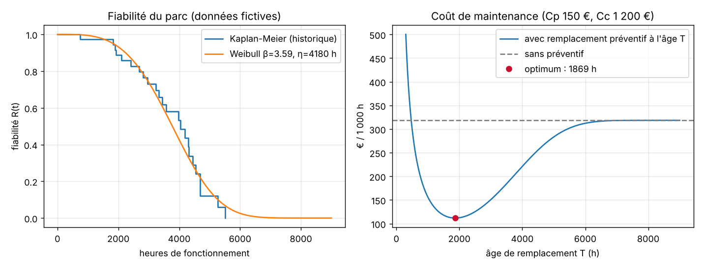

# MedPredict Reliability : fiabilité et maintenance des dispositifs médicaux

🇫🇷 [Français](#français) · 🇬🇧 [English](#english)



> Données **fictives**, générées pour l'exemple. Outil d'étude, pas un logiciel de gestion de parc biomédical.

---

## Français

### Le problème
Un service biomédical suit un parc d'appareils, par exemple des pousse-seringues. Certains sont déjà tombés en panne, d'autres fonctionnent encore. À partir de cet historique, on veut savoir :
- comment les appareils vieillissent : défauts de jeunesse, pannes au hasard ou usure ;
- la durée moyenne de bon fonctionnement (MTBF), et l'âge auquel 10 % du parc est tombé en panne (B10) ;
- s'il vaut mieux **remplacer une pièce de façon préventive**, et à quel âge, plutôt qu'attendre la panne.

### Ce que fait le code
- **Loi de Weibull** : fiabilité R(t), densité, taux de défaillance, MTBF = η·Γ(1 + 1/β), durée B10.
- **Estimation par maximum de vraisemblance avec censure** : les appareils encore en service comptent aussi. Les oublier ferait croire que les appareils vivent moins longtemps (c'est vérifié dans les tests).
- **Kaplan-Meier** : la courbe de fiabilité tirée directement de l'historique, pour juger si le modèle colle.
- **Remplacement préventif par l'âge** : coût horaire C(T) = [Cp·R(T) + Cc·(1 − R(T))] / ∫₀ᵀ R(t) dt, minimisé par une recherche sur grille puis une section dorée. Si β ≤ 1, le préventif ne sert à rien et l'outil le dit.
- **Disponibilité** : A = MTBF / (MTBF + MTTR).

### Utilisation
```bash
python analyse.py donnees/pousse-seringues.csv --cp 150 --cc 1200 --mttr 6
```
Sur les données d'exemple (40 appareils, 24 pannes, 16 encore en service) :
```
Weibull : beta = 3.59, eta = 4180 h -> usure (taux de défaillance croissant)
MTBF : 3767 h
B10 : 2235 h (10 % des appareils en panne)
Remplacement préventif conseillé toutes les 1869 h : 111.8 € / 1 000 h contre 318.6 € / 1 000 h sans préventif (65 % d'économie)
```
Le CSV contient trois colonnes : `appareil`, `heures`, `etat` (`panne` ou `en_service`).

### Fichiers
| Fichier | Contenu |
|---|---|
| `medpredict/fiabilite.py` | Weibull, estimation avec censure, Kaplan-Meier, maintenance préventive |
| `analyse.py` | rapport en ligne de commande |
| `donnees/pousse-seringues.csv` | historique fictif de 40 appareils |
| `figures.py` | figure ci-dessus (matplotlib) |
| `tests/test_fiabilite.py` | 26 vérifications : `python tests/test_fiabilite.py` |

Les tests vérifient notamment que l'estimation retrouve les vrais paramètres sur 20 000 tirages, avec et sans censure, que le MTBF est égal à l'intégrale de R(t), et que l'optimum de maintenance est le même qu'une recherche exhaustive.

### Limites
- Un seul mode de défaillance par appareil, et des appareils supposés identiques.
- Remplacement « à neuf » : on ne modélise pas les réparations imparfaites.
- Pas d'intervalle de confiance sur β et η : avec 24 pannes, l'incertitude reste importante.

Dépendance : `numpy` (et `matplotlib` pour la figure). Projet écrit en 2026.

---

## English

**Reliability and maintenance of medical devices.** From a fleet history (devices that failed and devices still running), the tool fits a Weibull law by maximum likelihood **with right-censoring**, computes MTBF, B10 life and availability, compares the fit with a Kaplan-Meier curve, and finds the **optimal age for preventive replacement** by minimising the long-run cost per hour. If β ≤ 1, preventive replacement is useless and the tool says so.

```bash
python analyse.py donnees/pousse-seringues.csv --cp 150 --cc 1200 --mttr 6
python tests/test_fiabilite.py   # 26 checks
```

Data are **fictitious**. Study tool, not biomedical asset-management software. Limits: single failure mode, identical devices, as-good-as-new replacement, no confidence intervals. Requires `numpy` (`matplotlib` for the figure). Written in 2026.
